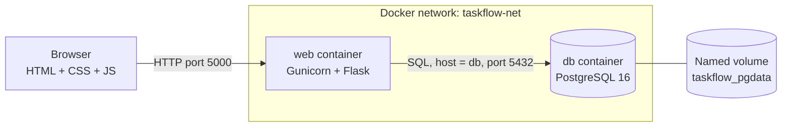

# TaskFlow: Smart Task Management Dashboard

A Dockerized task manager built with **Flask**, **PostgreSQL**, **Docker Compose** and **GitHub Actions**. Every task and every dashboard number is stored in and calculated from a real database.

## Problem statement
Students juggle assignments, lab records, exams and projects. Notes apps and chat messages get lost. TaskFlow gives one place to add tasks, set priorities and due dates, track progress, and see what is overdue.

## Objectives
- Build a working full-stack app (frontend, backend, database).
- Learn containerization: Dockerfile, Docker Compose, networks and volumes.
- Keep data persistent across container restarts.
- Add automated tests and a CI pipeline.

## Main features
- Create, view, edit and delete tasks (with a confirmation dialog before deleting).
- Status (To Do, In Progress, Completed) and priority (Low, Medium, High); due dates with clear overdue marking.
- One-click "mark as completed" and a status dropdown on every card.
- Search by title or description; filter by status, priority and due date; sort by created date or due date.
- Live statistics and a completion progress bar, all from the database.
- Toast notifications, loading skeletons, empty states, server-side validation messages.
- Responsive layout (sidebar becomes a slide-in menu on tablets and phones); keyboard-friendly and labelled forms.

## Technology stack
| Layer | Technology |
|---|---|
| Frontend | HTML5, CSS3, JavaScript, Bootstrap 5, Bootstrap Icons |
| Backend | Python 3.12, Flask, Gunicorn |
| Database | PostgreSQL 16 via Flask-SQLAlchemy |
| Containers | Docker, Docker Compose |
| CI | GitHub Actions |
| Tests | Pytest |

## Architecture


### How a request travels
1. You click **Add task**. `app.js` sends `POST /api/tasks` with JSON to `http://localhost:5000`.
2. Docker publishes container port 5000 to your PC's port 5000, so the request reaches **Gunicorn** in the `web` container.
3. Flask runs the route in `app/routes.py`. `app/validators.py` checks the data.
4. Flask-SQLAlchemy turns the `Task` model into an `INSERT`. It connects to the host name **`db`**. Compose puts both containers on the `taskflow-net` network and makes each service name a DNS name.
5. PostgreSQL stores the row in `/var/lib/postgresql/data`, which is the named volume `taskflow_pgdata`.
6. Flask replies with JSON. JavaScript shows a toast and reloads the list and statistics.

### How Docker Compose connects the services
- `db` uses the official `postgres:16-alpine` image. It has no `ports:` entry, so it is **not** reachable from your PC or the internet. Only `web` can talk to it.
- `web` is built from the `Dockerfile`. `depends_on: condition: service_healthy` makes it wait until `pg_isready` reports the database is ready.
- When `web` starts, it runs `flask init-db` (creates tables if missing, retries if the database is slow) and then starts Gunicorn. Tables are created **once, before** the workers start, so there is no startup race.
- Both read credentials from your `.env` file. The `.env` file is never copied into the image.

## Project structure
```
taskflow/
├── app/
│   ├── __init__.py        # app factory, error handlers, `init-db` and `seed-demo` commands
│   ├── models.py          # Task table
│   ├── routes.py          # pages + JSON API
│   ├── validators.py      # server-side validation
│   ├── templates/
│   │   ├── base.html      # layout: sidebar, toasts
│   │   ├── dashboard.html # main page
│   │   ├── task_form.html # add/edit form (included inside the dashboard modal)
│   │   ├── about.html     # settings and about
│   │   └── error.html     # friendly 404/500 page
│   └── static/
│       ├── css/style.css
│       └── js/app.js
├── tests/ (conftest.py, test_routes.py)
├── .github/workflows/ci.yml
├── config.py   run.py   requirements.txt
├── Dockerfile  compose.yaml  .dockerignore
└── .env.example  .gitignore  README.md
```
Differences from the suggested layout: `validators.py` keeps validation out of the routes, `error.html` provides friendly error pages, and `task_form.html` is a partial used inside the add/edit modal rather than a separate page (so adding and editing never reloads the page).

## Prerequisites (Windows)
1. **Docker Desktop** (with WSL 2 enabled). Open it and wait until it says "Engine running".
2. **VS Code** and **Git for Windows**.
3. Optional, only for running tests outside Docker: **Python 3.12**.

Check your tools in PowerShell:
```powershell
docker --version
docker compose version
git --version
```

## Run with Docker Compose
Open the project folder in VS Code, then **Terminal > New Terminal** (PowerShell). Every command below runs from the folder that contains `compose.yaml`.

**1. Create your `.env` file**
```powershell
Copy-Item .env.example .env
```
Open `.env` and set your own `POSTGRES_PASSWORD` and `SECRET_KEY`. To generate a key:
```powershell
python -c "import secrets; print(secrets.token_hex(32))"
```
(No Python installed? Type any long random string instead.) Leave `POSTGRES_HOST=db` as it is.

**2. Build and start**
```powershell
docker compose up --build -d
```
`--build` builds the image, `-d` runs in the background. The first run downloads images and takes a few minutes.

**3. Open the app:** http://localhost:5000

**4. (Optional) Add demo tasks for your presentation**
```powershell
docker compose exec web flask init-db
docker compose exec web flask seed-demo
```
`seed-demo` only adds tasks if the table is empty. You can delete them like any other task.

## Useful Docker commands
| Goal | Command |
|---|---|
| See running containers | `docker compose ps` |
| Follow logs of all services | `docker compose logs -f` |
| Logs of one service | `docker compose logs -f web` |
| Stop (keeps containers and data) | `docker compose stop` |
| Start again | `docker compose start` |
| Stop and remove containers (**data kept**) | `docker compose down` |
| Rebuild after changing code | `docker compose up --build -d` |
| Shell inside the web container | `docker compose exec web sh` |
| Open a PostgreSQL prompt | `docker compose exec db psql -U <POSTGRES_USER> -d <POSTGRES_DB>` |
| List volumes | `docker volume ls` |

Inside `psql` try: `\dt` (list tables), `SELECT * FROM tasks;`, `\q` (quit).

## Stop vs remove vs rebuild vs delete volume
| Action | What happens | Is your task data lost? |
|---|---|---|
| **Stop** (`docker compose stop`) | Containers pause, like switching a computer off. | No |
| **Remove containers** (`docker compose down`) | Containers are deleted, but the volume remains. | No |
| **Rebuild image** (`docker compose up --build`) | A new image is built from your code; containers are recreated. | No |
| **Remove volume** (`docker compose down -v`) | The `taskflow_pgdata` volume is deleted. | **YES, permanently** |

> **WARNING:** `docker compose down -v` (and `docker volume rm`) permanently deletes every task in the database. Only run it when you want a completely fresh start.

Proof of persistence for your demo: add a task, run `docker compose down`, then `docker compose up -d`. The task is still there.

## Run the tests
Tests use an **in-memory SQLite database** by default (or `TEST_DATABASE_URL` if set), so they can never change your development data. `conftest.py` refuses to run if the test database equals the development database.

**Locally (PowerShell, from the project folder):**
```powershell
python -m venv .venv
.\.venv\Scripts\Activate.ps1
pip install -r requirements.txt
python -m pytest -v
```
If PowerShell blocks the activate script, run `Set-ExecutionPolicy -Scope CurrentUser RemoteSigned` once and try again.

**Inside Docker:** the image does not include the `tests` folder (it keeps production images small), so run them in a throwaway container that mounts your code:
```powershell
docker run --rm -v "${PWD}:/app" -w /app python:3.12-slim sh -c "pip install -q -r requirements.txt && python -m pytest -v"
```

## GitHub Actions pipeline
The file `.github/workflows/ci.yml` runs on every push to `main` and every pull request that targets `main`. It:
1. checks out the code,
2. installs Python 3.12 and the dependencies,
3. runs the tests against a temporary PostgreSQL service (with a health check),
4. builds the Docker image to prove the `Dockerfile` works.

It does **not** deploy anywhere. Deployment is not configured.

**First push (PowerShell, after creating an empty repository on github.com):**
```powershell
git init
git add .
git commit -m "Initial commit: TaskFlow"
git branch -M main
git remote add origin https://github.com/<your-username>/<your-repo>.git
git push -u origin main
```
Check `git status` first: `.env` must **not** appear in the list.

**Viewing results:** open your repository on GitHub and click the **Actions** tab. A green check means all steps passed; a red cross means a step failed. Click the run, then the job, then the failed step to read its log.

## Troubleshooting
| Problem | Fix |
|---|---|
| `docker: command not found` or "cannot connect to the Docker daemon" | Start Docker Desktop and wait for "Engine running". |
| `SECRET_KEY is not set` in the web logs | You did not create `.env`. Run `Copy-Item .env.example .env`. |
| Port 5000 already in use | Change `APP_PORT=5001` in `.env`, run `docker compose up -d`, open http://localhost:5001. |
| "password authentication failed" | You changed `POSTGRES_PASSWORD` after the database was first created. The volume keeps the old password. Either change it back, or (**this deletes your data**) run `docker compose down -v` and start again. |
| Page loads but shows an error toast | Run `docker compose logs web` and read the last lines. |
| Changes to Python or HTML do not appear | Rebuild: `docker compose up --build -d`. |
| `web` keeps restarting | `docker compose logs web`. Usually a wrong `.env` value. |
| Icons or fonts missing | The page loads Bootstrap and fonts from a CDN, so it needs internet access. |

## Screenshots
Add your own screenshots to a `docs/screenshots/` folder and link them here.

| Screen | Screenshot |
|---|---|
| Dashboard | _add screenshot_ |
| Add task modal | _add screenshot_ |
| Filters and search | _add screenshot_ |
| Mobile view | _add screenshot_ |
| `docker compose ps` output | _add screenshot_ |
| Green GitHub Actions run | _add screenshot_ |

## Limitations and future enhancements
- Single user only: there is no login, so anyone who can open the site sees all tasks.
- Tables are created with `db.create_all()`, which does not change existing tables. A future model change needs **Flask-Migrate** (Alembic) migrations.
- Overdue is calculated with the server's date, not each user's time zone.
- The page loads Bootstrap and fonts from a CDN (internet required).
- Ideas: user accounts, categories and tags, drag-and-drop Kanban, email reminders, pagination, deployment to a cloud service.

## Viva questions you should be able to answer
- Why does Flask connect to the host `db` and not `localhost`? (Each container has its own `localhost`; Compose service names are DNS names on the shared network.)
- Why a named volume? (Container storage is deleted with the container; a volume lives separately.)
- Why Gunicorn instead of `flask run`? (Flask's built-in server is for development only.)
- Why a health check and `depends_on`? (PostgreSQL needs a few seconds to start; Flask must not start before it is ready.)
- Why validate on the server when the browser already checks? (Anyone can send requests without using your page.)
- Why is `.env` in `.gitignore` and `.dockerignore`? (Passwords must not reach GitHub or the image.)
